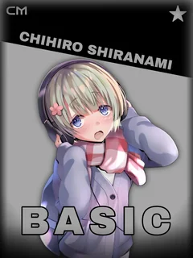
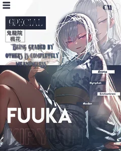
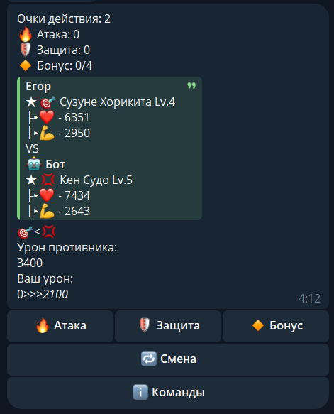
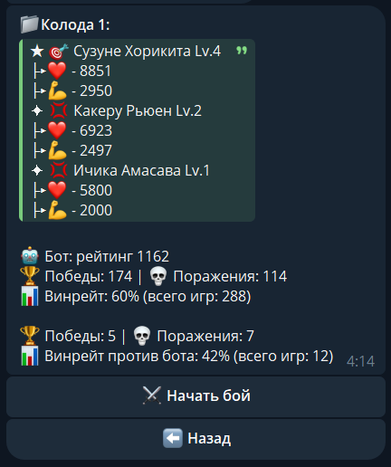

<div align="center">

<h1>COTE Megaverse</h1>

Telegram-бот [сообщества DCOTE](https://dcote.net): коллекционные карточки персонажей, прокачка, магазин и арена 3×3 с PvP и PvE против CFR-бота

[@Cotemega_bot](https://t.me/Cotemega_bot)

[О проекте](#о-проекте) · [Возможности](#возможности) · [Арена](#арена) · [Архитектура](#архитектура) · [Инженерные решения](#инженерные-решения) · [Разработка](#разработка)

[](https://python.org)
[](https://aiogram.dev)
[](https://postgresql.org)
[](https://redis.io)
[](https://rust-lang.org)
[](https://developers.cloudflare.com/r2/)
[](https://docker.com)

</div>

## О проекте

COTE Megaverse — Telegram-бот для сообщества по ранобэ «Добро пожаловать в класс превосходства». Игрок собирает карточки персонажей, прокачивает их за осколки и выводит тройку на арену: пошаговый бой 3×3, в котором часть информации о сопернике скрыта. Самое интересное здесь — арена: ходы бота в PvE считает CFR-решатель, алгоритм для игр с неполной информацией.

В детстве я делал карточки из бумаги по любимым вселенным и играл ими сам. Потом навыков стало больше, карточки стали цифровыми, а играть в них захотелось не только мне.

<p align="center">
  
  
  
</p>

<p align="center">
  
  
  
</p>

## Возможности

В коллекции шесть редкостей, от обычных карточек до специальных. Крутки бывают обычные и супер-крутки с гарантированным эпиком, а повторы превращаются в осколки и очки. У карточки есть тип и пол, статы растут с уровнем по кривой своей редкости, поэтому со временем разрыв между редкостями сокращается.

Уровни идут с 1 по 10, стоимость прокачки в осколках зависит от редкости. Раз в день игроку выпадает до трёх лотов на прокачку уже имеющихся карточек со скидкой 30%. Специальные карточки качаются только в магазине и по фиксированной цене за уровень. Осколки можно обменять на крутки.

На арене два режима: очередь на PvP и бой с ботом. PvE собирает колоду под статы игрока: против слабой тройки бот выставит сопоставимую.

Донат покупает осколки, оплата через DonationAlerts. Подробности — в разделе [«Донат без инвойсов»](#донат-без-инвойсов).

Админ-панель живёт в том же боте: браузер игроков с выдачей валюты и карточек, добавление и правка персонажей с загрузкой арта в R2, синхронизация каталога, рассылки и служебные сбросы.

Интерфейс двуязычный. При первом `/start` бот просит выбрать язык, дальше меню, имена карточек и лог боя идут на выбранном языке, а сменить его можно в профиле.

## Арена

Правила боя целиком описаны в [RULES.md](RULES.md), рейтинг, калибровка и сезоны — в [ARENA_RATING.md](ARENA_RATING.md).

У каждого по три персонажа, первый ход определяется при создании матча. За ход даётся пул очков действий, который нужно потратить целиком: атака, защита, бонус на следующий ход или смена активного персонажа. Типы образуют круг, урон по слабому типу — ×1.3, по сильному — ×0.7. Щиты и бонусы соперника видны только суммой, поэтому решения принимаются в условиях неполной информации.

PvE-ход считает [cotemegasolver](https://github.com/backspace-08/cotemegasolver) — CFR-решатель на Rust.

На ноябрь 2026 бот сыграл с игроками 288 матчей и выиграл 174 (60%).

<p align="center">
  
  
</p>

## Архитектура

Docker Compose поднимает три контейнера: `bot`, `postgres` и `redis`. Бот работает на long polling, если `WEBHOOK_URL` пуст, и переключается на вебхук, если он задан. Внутри процесса живёт aiohttp-сервер для health-check и OAuth-колбэка DonationAlerts.

Активные матчи лежат в Redis: состояние боя, очередь и привязка «игрок → матч» с TTL в 30 минут. Всё остальное, включая покупки и донаты, — в PostgreSQL. Каталог и арты хранятся в R2. `seed.py` скачивает `characters.json` по публичному `CHARACTERS_URL` при старте и удаляет карточки, которых в каталоге больше нет.

Решатель собирается отдельным этапом образа и ставится как Python-расширение `_cote_cfr`. Если его нет, PvE скрывается из меню, а остальной бот работает. Число одновременных PvE-игр ограничивает `CFR_MAX_ACTIVE`. Лимит подбирается под процессор.

## Инженерные решения

### Магазин, который не переигрывает день

Если роллить лоты от номера дня и общих весов, редкости получаются одинаковыми у всех, а правка весов задним числом меняет уже показанный день. Поэтому редкости роллятся на игрока (`user_id + day`), а выпавшая карточка и её редкость сразу фиксируются в `shop_rotation`: день нельзя перероллить ни новой версией конфига, ни рестартом. Если зафиксированная карточка больше не принадлежит игроку, например после сброса прогресса, слот переролливается, а не пропадает из магазина.

По весам в конфиге ожидается около семи специальных карточек за 90 дней на игрока. Раздача индивидуальная, поэтому у конкретного игрока их может быть и больше, и меньше.

### Донат без инвойсов

После блокировки платёжного провайдера оплата вернулась на DonationAlerts, где у бота нет инвойсов и вебхуков — только список донатов в API. Идентификатором заказа стала сумма: бот выдаёт точное число с копейками (номинал пачки минус небольшой диапазон), резервирует его на 48 часов и ищет платёж по сумме и валюте.

Ключевые ограничения заложены в схему. Сумма не переиспользуется, пока жив срок совпадения плюс кулдаун. Ровные суммы не выдаются, чтобы чужой платёж со стёртыми копейками не попал в чужой заказ. Если платёж совпал только по номиналу, заказ зачитывается, когда на пачку есть одна заявка. Если заявок несколько, каждому приходит кнопка «Это мой платёж», и осколки получает тот, кто нажмёт первым. По сумме нельзя понять, кто именно заплатил, поэтому первый нажавший забирает осколки, даже если платёж был не его. Это цена решения: автоматической проверки нет, но каждый зачёт виден админу, и спор можно разобрать вручную. Остальное, что не сошлось, ждёт в `/donations`.

### Каталог в R2 как источник правды

Карточки живут в `characters.json` и папках с артами, база — проекция каталога. Правка через `/edit_char` пишет новый файл, обновляет каталог и пересобирает базу. Имена файлов при замене арта не переиспользуются: CDN отдаёт картинки с годовым `immutable`-кешем, и повторное имя вернуло бы старую картинку из кеша.

### Локализация без второго дерева строк

Русский текст служит ключом перевода: английская таблица — словарь «русская строка → английская», а отсутствие перевода оставляет русский текст. Так не нужно держать ключи и тексты синхронно, но опечатка в исходной строке становится молчаливой. Поэтому отдельный тест проходит по исходникам и проверяет, что у каждого `t(...)` есть английский перевод.

## Разработка

Нужны Docker и заполненный `.env` (шаблон — [.env.example](.env.example)). Для запуска достаточно `BOT_TOKEN`, `ADMIN_ID` и параметров базы: `CHARACTERS_URL` указывает на публичный `characters.json`, поэтому доступ к бакету для чтения не нужен.

```bash
cp .env.example .env
docker compose up -d --build
```

При старте контейнер скачивает каталог и запускает бота. Для правки карточек в R2 понадобятся `R2_ACCESS_KEY_ID`, `R2_SECRET_ACCESS_KEY`, `R2_BUCKET` и `R2_ENDPOINT`. Без них `/add_char` и `/edit_char` откажутся работать, остальное останется доступно.

Тесты:

```bash
docker compose exec bot python -m unittest discover -s tests
```

Проверки покрывают Glicko-2, decay, таймеры арены и полноту английских переводов.

Донаты через DonationAlerts настраиваются один раз: приложение в кабинете DA, его `client_id` и ключ API в `.env`, адрес колбэка в настройках приложения, затем `/da_auth` в боте. Токены хранятся в базе и обновляются автоматически.

---

Проект неофициальный. Иллюстрации персонажей принадлежат их авторам и правообладателям серии «Добро пожаловать в класс превосходства». Код бота и дизайн карточек — мои.

<div align="center">

[backspace-08](https://github.com/backspace-08)

</div>
